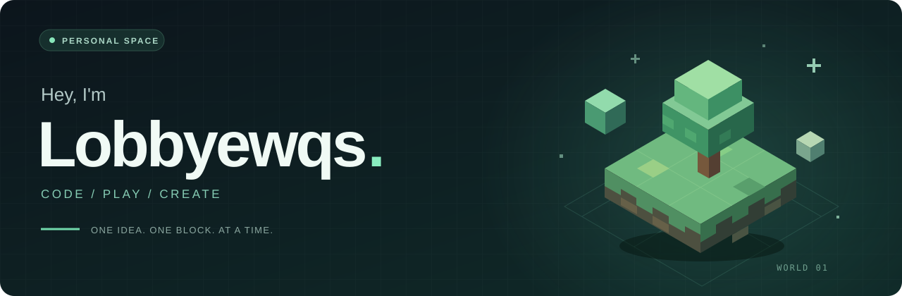

  

  <b>写一点代码，造一点有趣的东西。</b> 
  小工具 · 游戏 · 不设限的好奇心

  
  &nbsp;
  

 

### 👋 关于我

我是 **Lobbyewqs**，喜欢折腾小工具，也喜欢在游戏里探索与创造。  
这里记录我的代码实验与兴趣，慢慢把想法变成作品。

### 🎮 游戏时间

**Steam** · 发现好游戏，享受每一次开局。[来我的主页逛逛 ↗](https://steamcommunity.com/profiles/76561198273592524/)  
**Minecraft** · 一方块一方块，搭起自己的世界。

### 🧩 最近的小作品

[合成大西瓜助手](https://github.com/Lobbyewqs/--dy)：一个用于合成大西瓜的浏览器辅助小工具。

 

  

